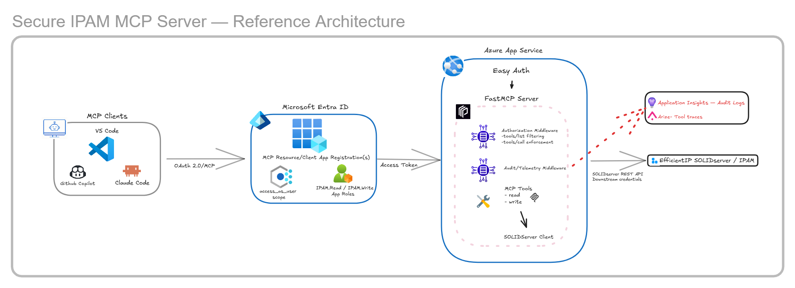

# Secure IPAM MCP Server - Architecture

## Overview

The Secure IPAM MCP Server exposes EfficientIP SOLIDserver IPAM
operations to MCP-compatible clients while keeping five concerns
separate:

1.  MCP user authentication
2.  MCP tool authorization
3.  deployment-level write policy
4.  downstream SOLIDserver authentication
5.  audit and observability



The primary hosted request flow is:

``` text
MCP Client
   -> Microsoft Entra ID
   -> Azure App Service Easy Auth
   -> FastMCP authorization
   -> MCP tool
   -> SolidServerClient
   -> EfficientIP SOLIDserver
```

Application Insights and Arize receive audit/trace telemetry outside the
downstream SOLIDserver request path.

## Components

### MCP Clients

Remote MCP clients connect over HTTP. Client-specific setup is
documented separately for VS Code + GitHub Copilot and Claude Code.
Clients authenticate to the MCP resource and separately provide the
credentials required by SOLIDserver.

### Microsoft Entra ID and Easy Auth

Microsoft Entra ID establishes the MCP user's identity. Azure App
Service Easy Auth protects the hosted endpoint and validates
authentication before requests reach FastMCP.

After authentication, App Service exposes principal information through
headers including:

``` text
X-MS-CLIENT-PRINCIPAL
X-MS-CLIENT-PRINCIPAL-ID
X-MS-CLIENT-PRINCIPAL-NAME
```

The application extracts App Role claims from this principal. It does
not use downstream SOLIDserver credentials as the MCP identity.

The API registration, delegated scope, token-version manifest setting,
App Roles, Easy Auth configuration, OAuth metadata, and client
registrations are covered in [Microsoft Entra Setup](entra-setup.md).

### FastMCP Server

FastMCP provides the MCP transport, tool registration, and middleware
pipeline.

The application registers 12 read tools, 2 write tools, authorization
middleware, audit/telemetry middleware, and FastMCP error handling.

The MCP application is mounted under `/ipam`, producing:

``` text
/ipam/mcp
```

A separate `/health` endpoint supports application readiness checks.

### SolidServerClient

`SolidServerClient` isolates vendor-specific HTTP behavior from the MCP
tool layer, including authentication headers, URL construction, TLS
verification, enterprise CA configuration, request timeout, and HTTP
errors.

MCP tools remain focused on agent-facing inputs, vendor operation
selection, and response transformation.

## Authorization Model

The reference implementation maps Entra App Roles to FastMCP tags:

``` python
ROLE_PERMISSIONS = {
    "IPAM.Read": {"read"},
    "IPAM.Write": {"read", "write"},
}
```

Tools declare their category directly:

``` python
@mcp.tool(tags={"read"})
async def get_sites(...):
    ...

@mcp.tool(tags={"write"})
async def add_ip_address(...):
    ...
```

### Tool Discovery

During `tools/list`, the middleware extracts the authenticated user's
roles, maps them to allowed tags, and returns only matching tools. A
user without a recognized role receives no tools. This is intentionally
fail closed.

### Tool Execution

Authorization is checked again during `tools/call`. The requested tool's
tags are compared with the caller's allowed tags.

A user with `IPAM.Read` therefore cannot invoke a write tool even if the
tool name is known and a direct call is attempted. Tool discovery is not
treated as the security boundary.

## Deployment-Level Read-Only Policy

The server supports an independent safety control:

``` env
IPAM_READ_ONLY=true
```

When enabled, write tools are removed from `tools/list` and direct write
calls are rejected. Neither `IPAM.Write` nor `AUTH_MODE=local` overrides
this policy.

## Local Development Mode

Easy Auth is unavailable when running directly on a developer
workstation.

``` env
AUTH_MODE=local
```

bypasses Entra RBAC only. It does not bypass SOLIDserver authentication
or `IPAM_READ_ONLY`.

Hosted deployments use:

``` env
AUTH_MODE=entra
```

Entra mode remains fail closed when a recognized role cannot be
established.

## Downstream SOLIDserver Authentication

MCP authentication and SOLIDserver authentication are separate security
contexts.

The MCP client supplies:

``` text
X-IPAM-Username
X-IPAM-Password
```

The user/audit middleware reads these headers during `tools/call` and
places the credentials in the FastMCP invocation context. They are not
required for MCP initialization or tool discovery.

`SolidServerClient` converts them into the vendor authentication
headers:

``` text
X-IPM-Username
X-IPM-Password
```

The downstream credentials are used only for SOLIDserver access and are
independent of the Entra access token. Passwords must never be written
to logs, audit events, or telemetry spans.

## Tool Layer

The server exposes 14 IPAM tools.

**Read:** `get_sites`, `get_site_info`, `get_subnets`,
`get_subnet_info`, `subnet_exists`, `get_list_of_ips`, `get_ip_info`,
`get_free_ips`, `get_free_address_list`, `get_used_address_list`,
`get_ip_pools`, `get_pool_info`.

**Write:** `add_ip_address`, `edit_ip_address`.

The MCP layer transforms SOLIDserver responses into smaller
agent-friendly structures rather than returning complete vendor
payloads.

Write operations deliberately use:

``` text
add_ip_address  -> add_flag=new_only
edit_ip_address -> add_flag=edit_only
```

so an add does not silently modify an existing address and an edit does
not silently create one.

## Audit and Observability

Tool invocation is wrapped by dedicated middleware.

### Application Insights

Structured audit events can capture the authenticated Entra identity,
roles, IPAM username, MCP tool, execution outcome, duration, and
rejection/failure reason.

The IPAM password, OAuth bearer token, complete request headers, and
downstream response payload are not logged.

The middleware inspects FastMCP `structured_content.status`, so a tool
call that completes at the MCP protocol level but reports a downstream
IPAM error is recorded as a failure rather than a success.

### OpenTelemetry and Arize

Each tool invocation can create an OpenTelemetry span such as:

``` text
mcp.tool.get_sites
```

Tool spans are marked:

``` text
openinference.span.kind = TOOL
```

and can contain tool name, execution status, duration, and configured
authorization/identity attributes.

Azure Monitor/Application Insights handles audit logging, while tool
spans can be exported to Arize through OTLP. Arize export is optional.

See [Observability](observability.md) for configuration and telemetry
details.

## Failure Boundaries

  Failure                          Enforcement point
  -------------------------------- ----------------------------------
  Unauthenticated MCP request      Azure App Service Easy Auth
  Missing/insufficient App Role    Authorization middleware
  Write blocked by server policy   `IPAM_READ_ONLY` enforcement
  Missing IPAM credentials         User/audit middleware
  Invalid downstream credentials   SOLIDserver
  SOLIDserver HTTP/API failure     Client/tool layer
  Unexpected tool exception        FastMCP error + audit middleware

Keeping these failure types distinct improves both troubleshooting and
audit interpretation.

## Security Boundaries

1.  **MCP client -\> Entra ID** establishes the MCP user's identity.
2.  **Easy Auth -\> FastMCP** supplies the trusted authenticated
    principal.
3.  **Authorization middleware -\> MCP tool** enforces App Roles and
    deployment policy.
4.  **MCP server -\> SOLIDserver** uses separate downstream credentials.
5.  **MCP server -\> observability backends** exports only approved
    telemetry.

The implementation follows fail-closed authorization, least privilege,
execution-time enforcement, credential separation, and sensitive-data
minimization.

## Testing the Architecture

Automated tests validate role-to-tag mapping, `tools/list` filtering,
`tools/call` enforcement, missing/unknown roles, local mode, read-only
enforcement, SOLIDserver client behavior, response formatting, and
write-result handling.

Two important security invariants are explicitly tested:

``` text
IPAM.Read + direct write tools/call = DENIED
IPAM.Write + IPAM_READ_ONLY=true = DENIED
```

The SOLIDserver boundary is mocked so unit tests do not require access
to a live IPAM environment.

## Related Documentation

-   [Microsoft Entra Setup](entra-setup.md)
-   [Observability](observability.md)
-   [VS Code + GitHub Copilot Setup](github-copilot.md)
-   [VS Code + Claude Code Setup](claude-code.md)

Environment-specific tenant IDs, client IDs, hostnames, credentials, and
resource identifiers belong in deployment configuration rather than
source-controlled architecture documentation.
